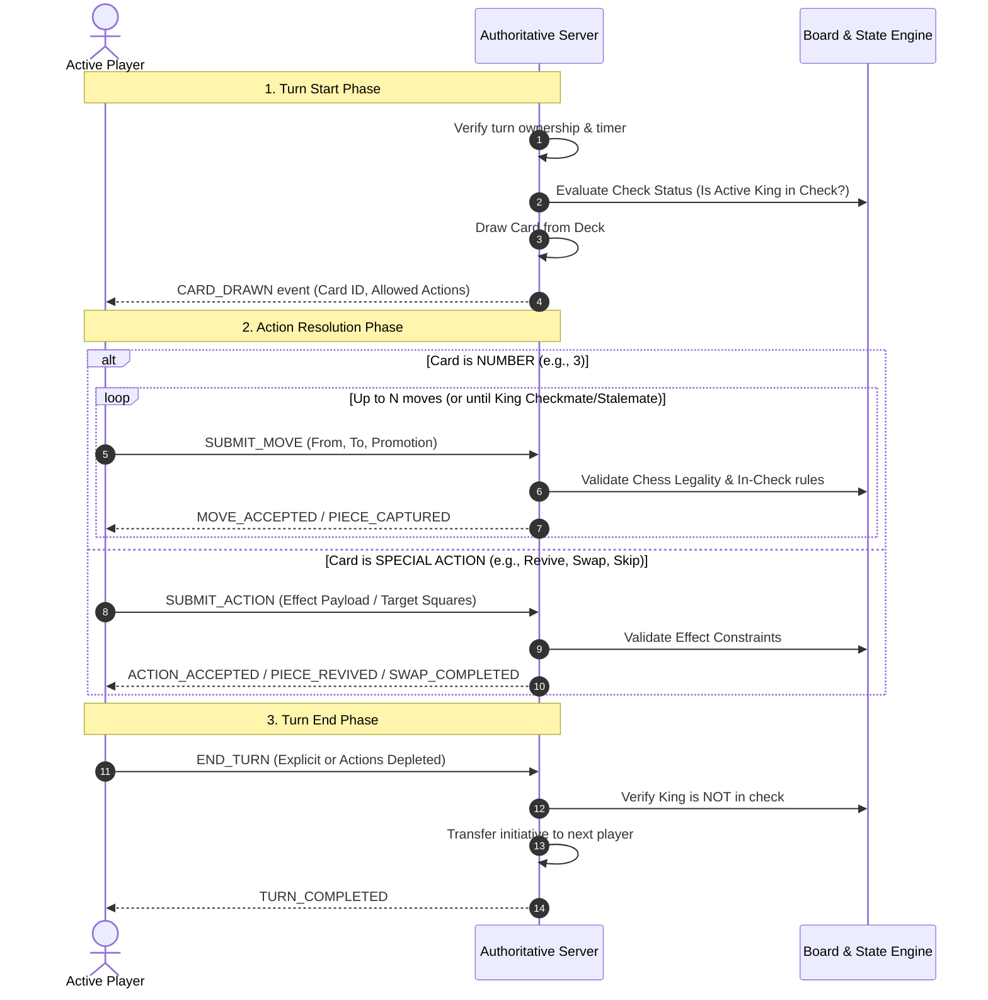

# Chess UNO — Game Rules Specification (Phase 0)

## 1. Executive Overview

**Chess UNO** fuses the positional depth and checkmate objective of classical chess with the tactical variance, dynamic tempo, and hand-management mechanics of UNO-style action cards.

All game mechanics are driven by an authoritative server-side state machine and configured via versioned JSON rules.

---

## 2. Status of Game Mechanics

To maintain architectural rigor, all mechanics are categorized into:
- **[CONFIRMED]**: Established and locked for baseline engine execution.
- **[PROPOSED]**: Viable default design modeled in the Phase 0 configuration.
- **[REQUIRES CLARIFICATION]**: Mechanics with notable edge cases requiring user/designer confirmation before Phase 1 engine implementation.

---

## 3. Turn Lifecycle

### Detailed Lifecycle Phases:
1. **Turn Start & Draw Phase [CONFIRMED]**:
   - The active player draws 1 card from the authoritative server deck.
   - Drawing is mandatory.
   - If the draw deck is empty, the discard pile (excluding the card currently in play) is securely reshuffled into a new draw deck.
2. **Action Phase [CONFIRMED]**:
   - The drawn card determines the player's available action pool for the turn.
   - Multiple moves granted by number cards can be taken using the same piece consecutively or across multiple pieces.
3. **Turn End Phase [CONFIRMED]**:
   - Turn ends once all available moves are consumed, or when the player legally declares end of turn (if permitted), or upon playing an instant turn-ending effect.
   - **Crucial Rule**: At the end of every legal turn, the active player's King must NOT be in check. Any sequence of moves that leaves the active King in check is illegal.

---

## 4. Card Mechanics & Resolution

| Card | Category | Default Quantity | Mechanics Status | Engine Interpretation |
|---|---|---:|---|---|
| **0** | Number | 4 | **[CONFIRMED]** | Grants 0 chess moves. Active player turn immediately passes without moving pieces. |
| **1–9** | Number | 8 each (72 total) | **[CONFIRMED]** | Grants up to $N$ standard legal chess moves ($N \in \{1..9\}$). Same piece may move multiple times. |
| **Reverse** | Action | 8 | **[PROPOSED]** | Swaps positions of two friendly non-king pieces on the board. |
| **Skip** | Action | 8 | **[CONFIRMED]** | Immediately skips the opponent's subsequent turn. The active player retains initiative and draws another card for a new turn. |
| **Draw Two (+2)** | Action | 8 | **[PROPOSED]** | Revives up to 2 captured friendly pieces into eligible unoccupied squares. |
| **Wild** | Wild | 4 | **[PROPOSED]** | Player selects 1 of 3 options: Make 1 chess move, Revive up to 2 pieces, or Swap 2 friendly pieces. |
| **Wild Draw Four (+4)** | Wild | 4 | **[PROPOSED]** | Player selects 1 of 2 options: Revive up to 4 pieces OR Revive up to 2 pieces + Make up to 2 chess moves. |

---

## 5. Capturing and Piece Revival Mechanics

1. **Capturing [CONFIRMED]**:
   - When a piece moves onto an enemy piece's square, the enemy piece is captured.
   - The captured piece is placed into the capturing player's friendly reserve (or owner's graveyard, see Questions section).
2. **Revival Eligibility [PROPOSED]**:
   - Pawns, Knights, Bishops, Rooks, and Queens can be revived.
   - Kings can never be revived (there is exactly 1 King per side).
   - If a player has fewer captured pieces in reserve than the card's revival limit, they may revive as many as are available (or 0 if reserve is empty).
3. **Revival Placement [PROPOSED]**:
   - Revived pieces must be placed on empty squares on the player's own half of the board (ranks 1–4 for White, ranks 5–8 for Black).
   - Pawns cannot be placed on rank 1 or rank 8 (promotion rank).

---

## 6. Check, Checkmate, and King Safety

1. **Strict King Safety [CONFIRMED]**:
   - A player cannot make any move or card action that leaves their own King in check at the conclusion of that action or turn.
2. **Turn Start in Check [CONFIRMED & PROPOSED]**:
   - If a player starts their turn in check, their actions MUST resolve the check.
   - If a player draws a `0` or `Skip` or `Revive` while in check, and cannot parry/block/escape check with that action, can the action be played? *(See Section 9: Decisions Requiring Clarification)*.
3. **Checkmate [CONFIRMED]**:
   - A player is in checkmate if their King is in check, and there is no legal move/action possible under their drawn card that escapes check.
   - If a player is in check and draws a card that gives 0 escape routes (e.g. Card 0, or card effects that cannot prevent capture on opponent's next turn), checkmate / defeat is triggered.

---

## 7. Draw Conditions [CONFIRMED]

Standard chess draw conditions apply:
- **Stalemate**: Active player has no legal moves/actions and is not in check.
- **Threefold Repetition**: Identical board position and castling/en-passant rights repeated 3 times.
- **Fifty-Move Rule**: 50 full turns without pawn move or piece capture.
- **Insufficient Material**: Neither side has sufficient pieces to deliver checkmate.
- **Mutual Agreement**: Both players agree to a draw.

---

## 8. Edge Cases & Concurrency

1. **Multiple Moves with Same Piece**:
   - If a Pawn advances two squares on move 1 of a multi-move turn, en passant rights are generated. If the opponent cannot act immediately (e.g. active player has moves remaining), en passant is only capturable on the opponent's immediate next turn.
2. **Pawn Promotion During Multi-Move**:
   - If a Pawn reaches the promotion rank on move 1 of a 3-move card, it immediately promotes to the chosen piece (e.g. Queen). Moves 2 and 3 may immediately be executed with that newly promoted Queen.
3. **Deck Exhaustion**:
   - When the deck runs out, the discard pile is collected, shuffled deterministically via server cryptographically secure RNG, and set as the new draw deck.

---

## 9. Decisions Requiring Clarification

The following 4 design decisions require clarification:

1. **Captured Piece Ownership for Revival**:
   - *Option A (Reserve/Drop-style like Shogi)*: When White captures Black's Knight, White adds it to White's reserve and can revive it as a White piece.
   - *Option B (Graveyard/Resurrection style)*: When White captures Black's Knight, it goes to Black's casualty graveyard, and only Black can revive it when Black plays a revival card.
2. **In-Check Drawing a Non-Move Card**:
   - If White is in Check and draws a `0` (Pass) or `Reverse` (Swap):
     - Does White immediately lose by Checkmate?
     - Or does White automatically discard and redraw / forfeit only if no legal moves exist across any card?
3. **Consecutive Checks During Multi-Move**:
   - During a multi-move card (e.g. Card 3), can White place the Black King in check on move 1, and capture the King on move 2?
   - Or does classical check apply, meaning checking the opponent immediately ends the active player's turn?
4. **Reverse Card Scope**:
   - Does `Reverse` allow swapping any two friendly pieces regardless of distance, or only adjacent pieces? Does swapping swap pieces with Kings excluded?

