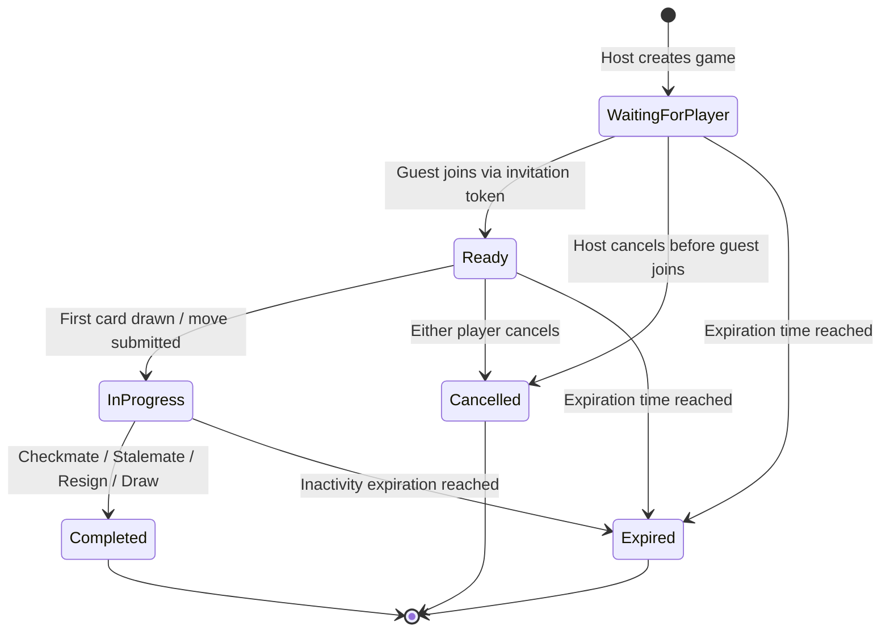

# Chess UNO — Session Lifecycle & Reconnection Protocol

## 1. Lifecycle State Machine

A Chess UNO game progresses through deterministic, non-reversible lifecycle states:



### State Definitions
- **`WaitingForPlayer`**: Session created by Player White; awaiting Player Black to join using `InvitationToken`. Only White is authorized.
- **`Ready`**: Player Black joined. Both player tokens are active. Awaiting first turn action.
- **`InProgress`**: Moves or card draws have been executed. Revision increments with every state change.
- **`Completed`**: Match has concluded via checkmate, resignation, timeout, or draw rules. All further state-mutating actions are permanently rejected.
- **`Expired`**: Match exceeded configured time-to-live (`lifetime`) without concluding. Cleaned up by background job.
- **`Cancelled`**: Cancelled by mutual consent or host abort prior to completion.

---

## 2. Reconnection Protocol

When a player refreshes their browser or loses internet connectivity:

### 2.1. Client Reconnection Workflow
1. The Svelte application stores `{ gameId, playerToken, assignedColor, playerName }` in `sessionStorage`.
2. On page reload, the client detects `sessionStorage.getItem('chess_uno_session')`.
3. The client invokes SignalR `connect()` and calls `JoinGameRoom(gameId, playerToken)`.
4. The server validates `playerToken` against `PlayerWhite.SecretToken` and `PlayerBlack.SecretToken`.
5. Upon successful validation:
   - The server marks the player `IsConnected = true` in PostgreSQL and in-memory cache.
   - The server sends the caller a full `GameStateSnapshot` with current FEN, reserves, legal moves, remaining moves, active card, turn phase, and monotonic `Revision`.
   - The server broadcasts `PlayerConnected` to the opponent with `{ PlayerName, Color, IsReconnected = true }`.
   - The client seamlessly re-establishes WebRTC signaling.

### 2.2. Disconnection Notification
When a SignalR connection drops:
1. `GameHub.OnDisconnectedAsync` triggers.
2. The server updates `PlayerWhiteConnected = false` (or Black) in PostgreSQL.
3. The server broadcasts `PlayerDisconnected` to the remaining opponent in the room:
   ```json
   {
     "playerName": "Bob",
     "color": "Black"
   }
   ```
4. The opponent UI displays an informative toast ("Opponent disconnected; waiting for reconnect...").

